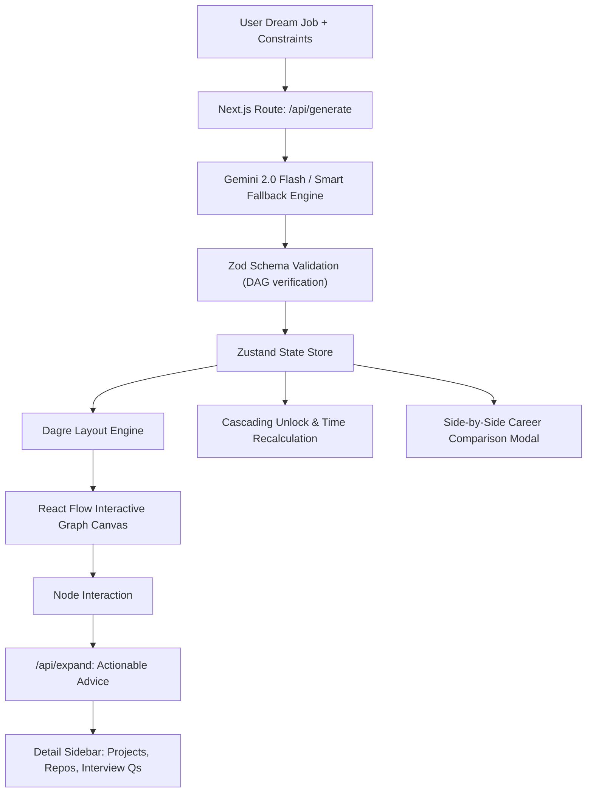

# 🗺️ Career Roadmapper — AI-Powered Reverse-Engineered Career Paths

> **Transform vague dream jobs into interactive, non-linear visual skill trees with concrete stepping stones, real repositories, and actionable interview prep.**

---

## 💡 The Problem

Most career advice given to college students is painfully generic:
> *"Want to be a Frontend Engineer? Just learn React and build a portfolio."*

Real-world career navigation requires nuanced, context-aware steps:
- **Domain-specific prerequisites** (e.g., carbon accounting APIs for Climate Tech, FHIR protocols for HealthTech, PCI-DSS compliance for Fintech).
- **Realistic stepping stones**: Intermediate roles (Junior QA, Support Engineer, Data Analyst) rather than jumping directly to Senior/Lead.
- **Accredited industry certifications** that recruiters actually look for.
- **Actionable micro-deliverables** rather than passive checklists.

**Career Roadmapper** reverse-engineers any target role into an interactive Directed Acyclic Graph (DAG) skill tree — with zoom, pan, real repos, interview questions, dynamic re-routing, and side-by-side career comparisons.

---

## 🚀 Key Features

### 1. 🎯 Hyper-Specific AI Reverse-Engineering
- Enter exact roles: *"Full Stack Developer at a climate tech startup"*, *"ML Engineer in healthcare"*, *"Frontend Engineer at FAANG"*.
- Configurable constraints: Hours available per week, target timeline, and pre-existing skills.

### 2. 🌳 Non-Linear Interactive Skill Tree (DAG)
- Powered by **React Flow** and **Dagre** auto-layout.
- 5 distinct node types:
  - 🎯 **Milestones** (Major achievements & deliverables)
  - 🧠 **Skills** (Core frameworks & theoretical foundations)
  - 🔨 **Projects** (Real-world portfolio projects)
  - 📜 **Certifications** (Accredited industry credentials)
  - 💼 **Roles** (Intermediate stepping-stone positions)
- Visual states: **Locked 🔒**, **Available 🟢**, **In Progress 🔵**, **Completed ✅**, and **Skipped ⏭️**.

### 3. ⚡ Dynamic Re-Routing & Cascading Unlocks
- Marking a skill as *"I Already Know This"* cascades unlocks to dependent downstream nodes.
- Recalculates estimated time to completion automatically.

### 4. 🛠️ Actionable Detail Slide-Out Panel
Clicking any node reveals deep actionable intelligence:
- 🔨 **Weekend Project Idea**: Complete specification with tech stack and time estimate.
- 📂 **Real GitHub Repositories**: Annotated with *why* you should study their code.
- ❓ **Targeted Interview Questions**: 5 technical questions specific to that exact node.
- 📚 **Curated Learning Resources**: Official documentation, articles, and courses.
- 💡 **Insider Pro-Tip**: Battle-tested guidance from industry engineers.

### 5. ⚖️ Side-by-Side Career Comparison
- Compare two dream careers simultaneously (e.g. *Full Stack Dev* vs *DevOps Lead*).
- Overlap metric (% synergy) and identification of **transferable stepping stones**.
- Calculation of estimated time saved by leveraging common skills.

### 6. 📸 Export & Share
- High-resolution **PNG export** with one click.
- Shareable links for mentors and peer study groups.
- Celebratory confetti effects upon completing milestones.

---

## 🏗️ Architecture



---

## 🛠️ Tech Stack

| Layer | Technology |
|:---|:---|
| **Framework** | [Next.js 16 (App Router)](https://nextjs.org/) + React 19 |
| **Interactive Graph** | [@xyflow/react (React Flow)](https://reactflow.dev/) + [Dagre](https://github.com/dagrejs/dagre) |
| **Animations** | [Framer Motion](https://www.framer.com/motion/) + [Canvas Confetti](https://github.com/catdad/canvas-confetti) |
| **State Management** | [Zustand](https://github.com/pmndrs/zustand) with LocalStorage persistence |
| **AI Engine** | [Google Gemini 2.0 Flash](https://ai.google.dev/) via `@google/generative-ai` |
| **Validation** | [Zod](https://zod.dev/) |
| **Styling** | Vanilla CSS Tokens (Dark Mode & Glassmorphism) |
| **Export** | [html-to-image](https://github.com/bubkoo/html-to-image) + [file-saver](https://github.com/eligrey/FileSaver.js) |

---

## 📦 Getting Started

### 1. Prerequisites
- Node.js 18+ installed

### 2. Install Dependencies
```bash
npm install
```

### 3. Environment Variables (Optional)
Create a `.env.local` file:
```env
GEMINI_API_KEY=your_gemini_api_key_here
```
> *Note: If no API key is set, the application automatically activates its high-fidelity domain fallback generator, ensuring a 100% functional demo out of the box.*

### 4. Run Development Server
```bash
npm run dev
```
Open [http://localhost:3000](http://localhost:3000) in your browser.

### 5. Production Build
```bash
npm run build
npm start
```

---

## 🎯 3-Minute Demo Flow

1. **Landing Hero**: Type a specific role like `"Full Stack Developer at a climate tech startup"` or pick a Quick-Start template.
2. **Explore Skill Tree**: Zoom, pan, and inspect the phase breakdown (Foundations → Full Stack → APIs → Open Source → Placement).
3. **Actionable Panel**: Click `"Master TypeScript & Modern React 19"` to view the weekend project, real GitHub repos, and interview questions.
4. **Dynamic Re-Routing**: Click *"I Already Know This"* — observe the cascading unlock to downstream nodes and updated timeline.
5. **Mark Progress**: Click *"Mark Complete"* to trigger celebratory milestone confetti.
6. **Career Comparison**: Click `"Compare Careers"` in the top navigation bar to compare against *"DevOps Lead"*, highlighting overlapping transferable skills.
7. **Export**: Click `"Export PNG"` to download the complete roadmap diagram.
